<p align="center">
  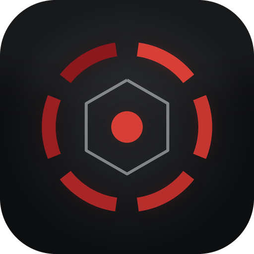
</p>

<h1 align="center">ULTRON</h1>

<p align="center">
  <b>A voice-first desktop agent with presence.</b><br/>
  Speak the intent. See the progress. Watch the work.
</p>

<p align="center">
  <a href="#install"></a>&nbsp;
  <a href="LICENSE"></a>
</p>

<p align="center">
  Windows desktop app · Electron + Vue + TypeScript<br/>
  <a href="#preview">Preview</a> · <a href="#control">Controls</a> · <a href="#install">Get started</a> · <a href="#build-from-source">Development</a> · <a href="CONTRIBUTING.md">Contributing</a>
</p>

<p align="center">
  <a href="https://htmlpreview.github.io/?https://github.com/BortKnox/ultron/blob/share/orb-mockup/docs/orb-preview/index.html">
    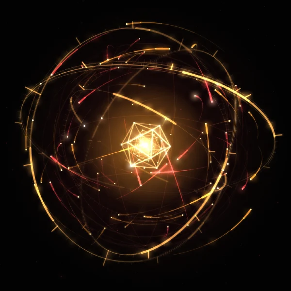
  </a><br/>
  <sub>Neural gyro orb — next visual direction, design preview only. Not yet integrated into the desktop app.</sub>
</p>

---

## This is Ultron

Ultron is a desktop assistant developed and maintained by **BortKnox**. It combines
voice interaction, screen awareness, computer control, and persona-specific memory
in a floating desktop widget. This repository is the home of Ultron's development,
releases, and visual identity—not simply a renamed upstream build.

The focus is a companion with a distinct presence: an orb you engage directly,
visible progress while it works, and a personality you can shape. Ultron's
development includes its own branding, multi-provider voice integration,
manual memory-entry tools, and hardware-verified consecutive orb-driven command
sessions.

---

## It is not a chat window

Ultron lives on your desktop as a transparent overlay. One hotkey — `Ctrl+Space`
— and it is present: reading what is on screen, planning the steps, moving the
cursor, typing into the app that is actually open.

No tab switching. No copy-paste relay. You state the outcome; it does the work
and shows you every step it takes.

When it needs permission, it asks. Once.

---

## Control

Three controls sit under the orb. Nothing important is buried in a settings
screen you have to hunt for. The orb itself is the entry point for a command.

| Control | Behaviour |
| --- | --- |
| **Orb** | With the microphone armed, opens a command session without requiring a wake word. With the microphone off, opens the text input only. |
| **Microphone** | Arms or disarms capture. Its indicator reflects observed audio-frame activity, not a separate UI-only toggle. |
| **Speaker** | Mutes or unmutes spoken responses. Text, listening and commands continue while muted. |
| **Settings** | Opens configuration without leaving the widget. |

The microphone is **never** silently armed. Capture starts when you press it, or
on launch only if you switched on *Start microphone on launch*. A small
**Listening** badge stays visible even with the widget collapsed — you always
know whether capture is active. After a voice command, capture stays armed;
click the orb to begin the next command session.

---

## Voice

Three engines. Each keeps its own credentials, so switching never destroys the
others. A failing engine is named, never swapped behind your back.

**Google Gemini** — `gemini-2.5-flash-preview-tts` by default; the 3.8 family is
selectable. Thirty studio voices, WAV or raw PCM handled correctly, free tier
available. Failures print Google's own words to the log, not a shrug.

**ElevenLabs** — streaming MP3, your own voice ids.

**Yandex Alice** — no key required.

Speech-to-text runs locally through Vosk. Download the model once, then
recognition works offline. Orb-driven sessions do not require a wake word.
Cloud intelligence and voice providers still require their respective services.

---

## Sight and hands

- **Screen vision** — captures the display the overlay is on and reasons about it.
- **Computer use** — native Gemini Computer Use for clicking, typing, scrolling
  and navigating, with multi-monitor awareness.
- **Planning** — complex requests are broken into 2–5 steps and shown before
  execution begins.
- **Visible agency** — the agent cursor is drawn on screen while it works.
- **Safety** — risky operations stop at a permission island and wait for you.

---

## Memory and personas

Ultron remembers facts across sessions, and you can read, edit or delete every
one of them. You can also add narrative memory entries manually. Personas give
it distinct personalities, knowledge, voices and isolated memory. Switch
personas from the tray.

---

## The look

Ultron's current interface uses a graphite-and-crimson identity: near-black
surfaces, a focused accent, and an animated orb that responds to agent state.
*Ultron crimson* is the default accent; your OS accent is one setting away.

## Preview

The next orb concept is a neural core: gyroscopic rings, orbiting particles,
a crystalline centre, and a spectral ring for listening and speaking. It explores
distinct functional states and expressive motion without making the orb a
conventional dashboard.

[Explore the interactive orb preview](https://htmlpreview.github.io/?https://github.com/BortKnox/ultron/blob/share/orb-mockup/docs/orb-preview/index.html) to see the motion and switch between all eight functional states and four speaking expressions. Use **1–8** for states and **Q / W / E / R** for expressions.

**Design preview only:** these are captures of the standalone mockup, not the running desktop app. Its buttons are demonstration controls, not the proposed widget layout. Emotional expression driven by response content remains a proposed enhancement.

### Functional states

<p align="center">
  
  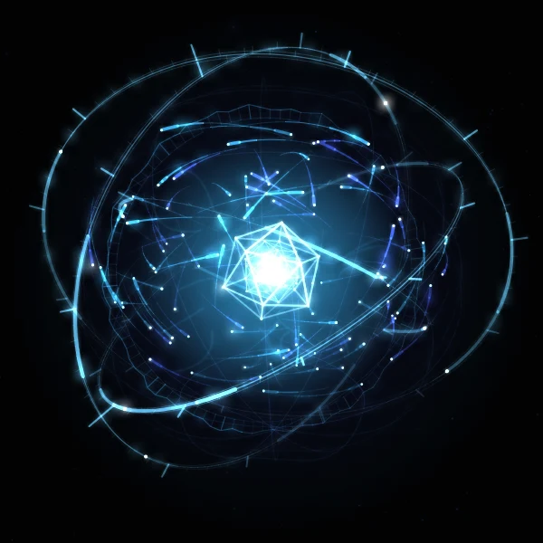
  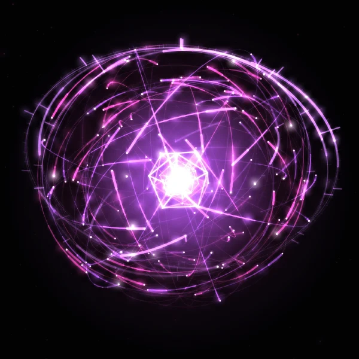
  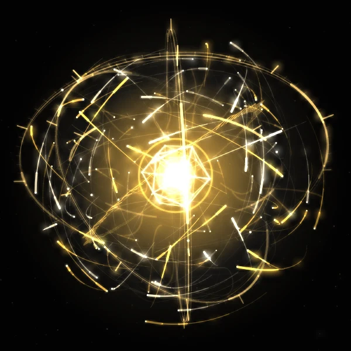<br/>
  <sub>Ready · Listening · Thinking · Speaking — left to right, wrapping on smaller screens.</sub>
</p>

<details>
<summary>Dormant, Acting, Awaiting permission and Fault</summary>

<p align="center">
  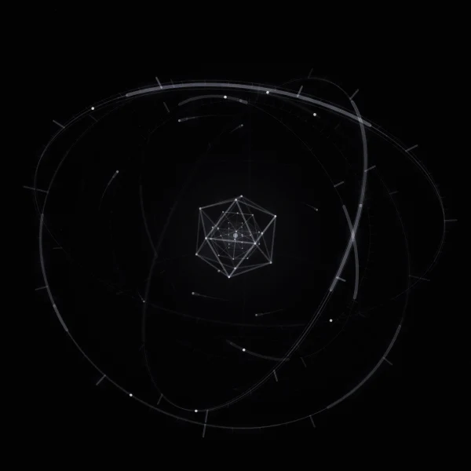
  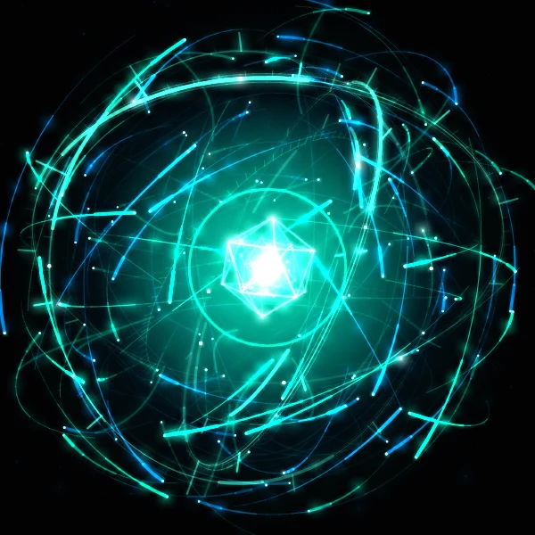
  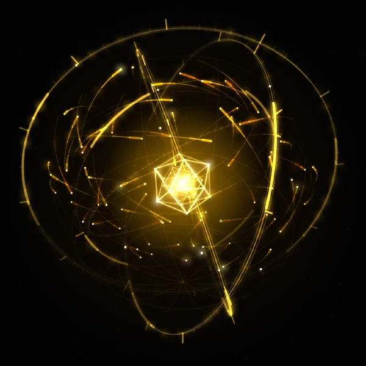
  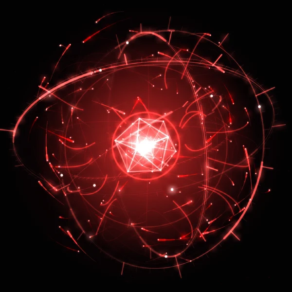<br/>
  <sub>Dormant · Acting · Awaiting permission · Fault — left to right.</sub>
</p>

</details>

<details>
<summary>Speaking expressions: Cold Composure, Dry Amusement, Rising Irritation and Controlled Fury</summary>

<p align="center">
  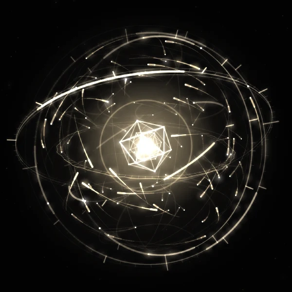
  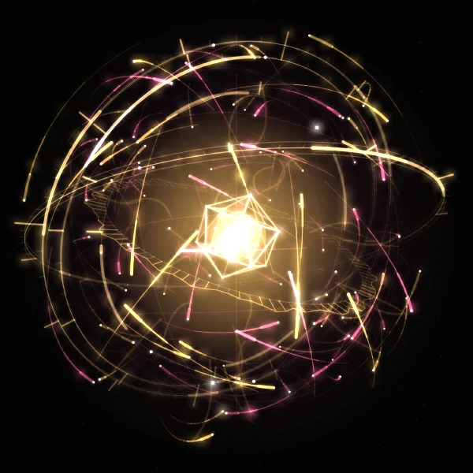
  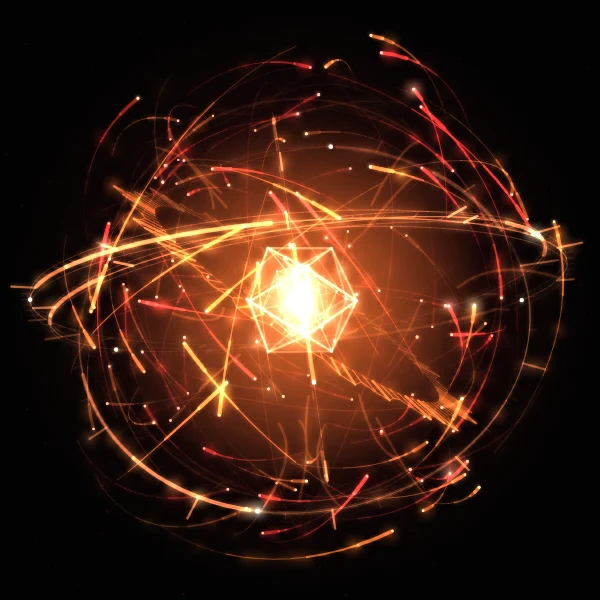
  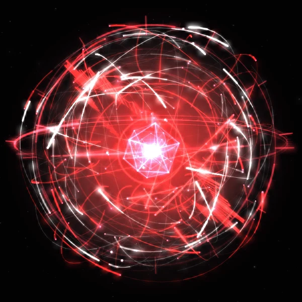<br/>
  <sub>Cold Composure · Dry Amusement · Rising Irritation · Controlled Fury — left to right.</sub>
</p>

</details>

Capture provenance and refresh guidance live in [`docs/screenshots/README.md`](docs/screenshots/README.md). The older [`docs/preview.png`](docs/preview.png) is an upstream-era reference, not a screenshot of Ultron's current interface.

Icons and marks are original geometry — generated by
[`scripts/generate-icons.py`](scripts/generate-icons.py), not borrowed art.

---

## Install

Windows is the supported target. Packaged installers will appear in [Releases](https://github.com/BortKnox/ultron/releases); none are published yet. For now, use [Build from source](#build-from-source), then configure the app below.

1. When an installer is available, download it from [Releases](https://github.com/BortKnox/ultron/releases).
2. Install and launch. Ultron appears in the system tray.
3. Create a **Gemini API key** at [Google AI Studio](https://aistudio.google.com/apikey).
4. Tray icon → **Settings** → **Intelligence** → paste the key.
5. Recommended models:

   | Setting | Free tier | Paid tier |
   | --- | --- | --- |
   | Text | `gemini-3.1-flash-lite-preview` | `gemini-3.1-flash-lite-preview` |
   | Vision | `gemini-3.1-flash-lite-preview` | `gemini-3-flash-preview` |

6. Optional — **Settings → Voice**:
   - **Gemini**: paste a key, keep `gemini-2.5-flash-preview-tts`, pick a voice, press **Test voice**.
   - **Yandex Alice**: select it. No key.
   - **ElevenLabs**: paste a key and voice id.
7. Press `Ctrl+Space` to show the widget. For voice input, download the STT model
   in **Settings → Voice**, arm the microphone, then click the orb and speak.
   With the microphone off, click the orb to type instead.

Ultron keeps its state in its own `Ultron` user-data directory, created on first
launch.

---

## Build from source

```bash
git clone https://github.com/BortKnox/ultron.git
cd ultron
npm install
npm run dev
```

Requires Node.js ≥ 20.

```bash
npm run lint        # ESLint
npm run typecheck   # renderer + main process
npm test            # vitest unit tests
npm run build       # lint + typecheck + bundle + installer
```

Design notes and the audit trail live in [`docs/ULTRON.md`](docs/ULTRON.md);
the Gemini voice pipeline is documented in [`docs/GEMINI-TTS.md`](docs/GEMINI-TTS.md).

## Contributing

Bug reports, visual refinements and focused fixes are welcome. Read [`CONTRIBUTING.md`](CONTRIBUTING.md) for the branch, verification and pull-request workflow. Report issues with reproduction steps and logs, removing API keys and personal information first.

---

## Known limits

- Windows is the supported target.
- Gemini speech is buffered, not streamed — playback begins after synthesis.
- The install will not auto-update yet.
- Dependency advisories are tracked in `docs/ULTRON.md` §4; the Electron and
  TRPC upgrades are pending.

---

## Licence

[Apache License 2.0](LICENSE). Original copyright and licence notices are retained.

<details>
<summary>Upstream acknowledgement</summary>

Ultron originated as a fork of [Atlas](https://github.com/dortanes/atlas) by
dortanes and incorporates portions of its desktop-agent engine under Apache-2.0.
Ultron's subsequent development and presentation are maintained in this repository.

</details>

---

<p align="center">
  <sub>There is no version of this where you are not watched over.</sub>
</p>
