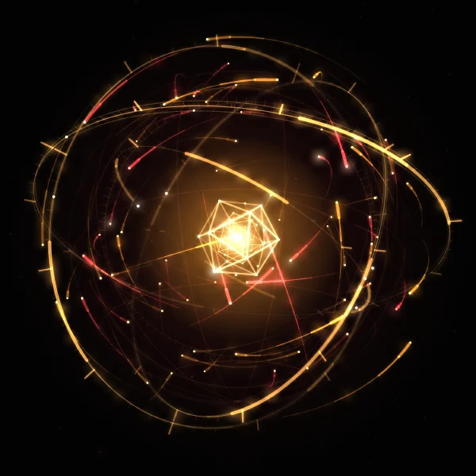
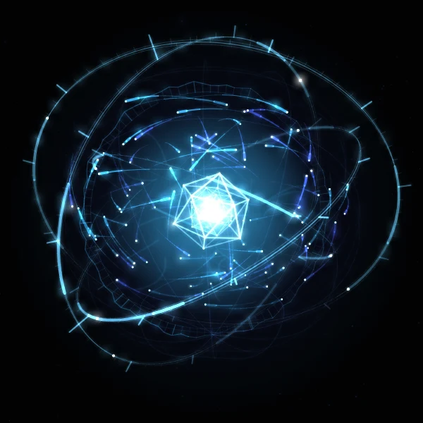
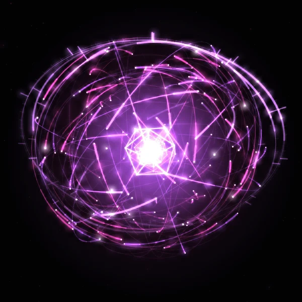
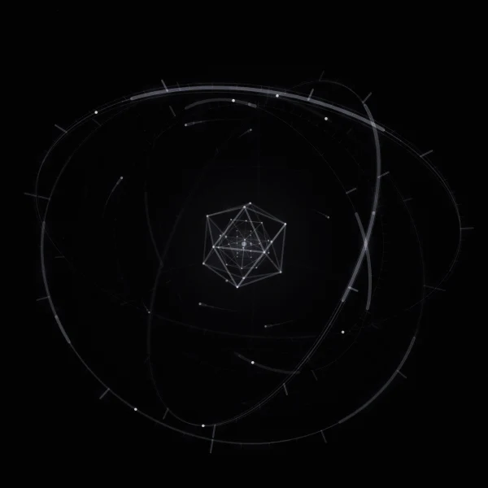
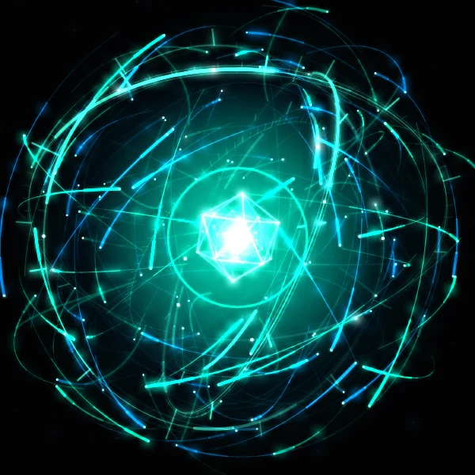
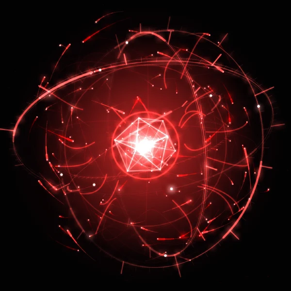
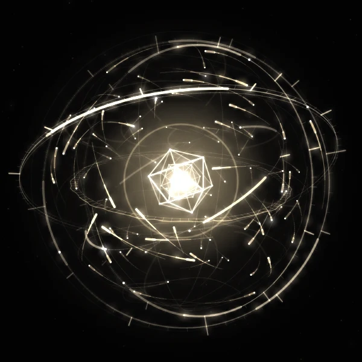
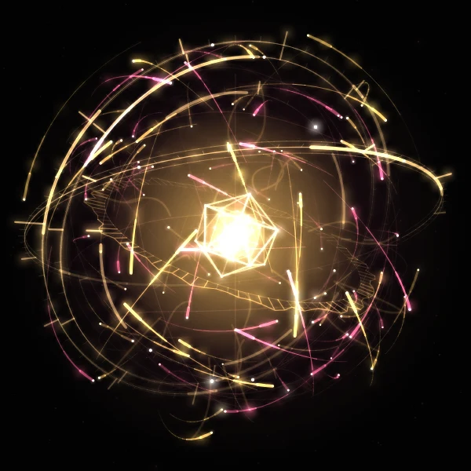
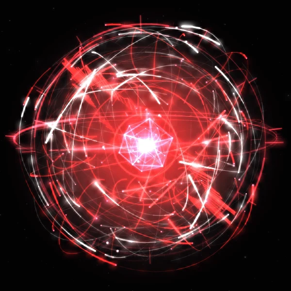

# ULTRON

**A desktop AI agent that sees your screen, speaks, and operates your computer. State the outcome; it plans the steps and does the clicking.**

```
UNIT     ULTRON
TYPE     AGENT
STACK    ELECTRON / VUE 3 / TYPESCRIPT / GEMINI
STATUS   ACTIVE — WINDOWS ONLY, NO INSTALLER YET
```



*Neural gyro orb: the next visual direction. Design preview only, not yet in the desktop app.*

## WHAT IT DOES

Ultron lives on your desktop as a transparent overlay. One hotkey, `Ctrl+Space`, and it is present: reading
the screen, planning the steps, moving the cursor, typing into the app that is actually open. It is not a
chat window. There is no tab switching and no copy-paste relay, and every step it takes is shown.

Simple commands take a direct shell or keyboard route. Tasks that need the screen use screenshot-guided
interaction. Voice, persona-specific memory and a floating widget sit on top of the computer-use engine.

## CAPABILITIES

| Capability | What it does |
|---|---|
| **Mouse and keyboard** | Click, double-click, right-click, type, scroll and use shortcuts in real applications and browser pages. |
| **Screen awareness** | Captures the display the overlay is on, reads it, and uses the next screenshot to guide the next action. Multi-monitor aware. |
| **Windows commands** | PowerShell for file operations, app launch and system queries when a command beats GUI navigation. |
| **File and web search** | Filename search across common user folders, plus online lookup, as separate tools. |
| **Multi-step tasks** | Builds a high-level plan, shows progress, and acts toward the outcome within configured limits. |

Example requests, as general capabilities and not separately tested features: organise a project folder and
review likely duplicates before anything is deleted; open System Information and Task Manager and suggest
improvements without changing anything; work across several apps in one task; research a setting, open the
page and walk through the options. For cleanup or configuration work, start with a read-only review and keep
backups.

Implementation: [action dispatcher](electron/main/services/motor/MotorService.ts) ·
[PowerShell controller](electron/main/services/motor/ShellController.ts) ·
[computer-use loop](electron/main/services/agent/ComputerUseLoop.ts) ·
[task planner](electron/main/services/agent/TaskPlanner.ts) ·
[search service](electron/main/services/search/SearchService.ts)

## CONTROLS

Three controls sit under the orb.

| Control | Behaviour |
|---|---|
| **Orb** | With the microphone armed, opens a command session without a wake word. With the microphone off, opens text input. |
| **Microphone** | Arms or disarms capture. The indicator reflects observed audio-frame activity. |
| **Speaker** | Mutes or unmutes spoken replies. Text, listening and commands continue while muted. |
| **Settings** | Opens configuration without leaving the widget. |

The microphone is never silently armed. Capture starts when you press it, or on launch only if you enable
*Start microphone on launch*. A **Listening** badge stays visible even when the widget is collapsed. After a
voice command capture stays armed; click the orb to start the next session.

## VOICE

Three engines. Each keeps its own credentials, and a failing engine is named, never silently swapped.

| Engine | Notes |
|---|---|
| **Google Gemini** | `gemini-2.5-flash-preview-tts` by default, 3.8 family selectable. Thirty voices, free tier available. Failures log Google's own error text. |
| **ElevenLabs** | Streaming MP3 with your own voice IDs. |
| **Yandex Alice** | No key required. |

Speech-to-text runs locally through Vosk: download the model once and recognition works offline. Cloud
intelligence and voice providers still need their respective services.

## MEMORY AND PERSONAS

Ultron remembers facts across sessions, and every one can be read, edited or deleted. You can also add
narrative memory entries by hand. Personas carry their own personality, knowledge, voice and isolated
memory, and switch from the tray.

## ORB DESIGN PREVIEW

The next orb concept is a neural core: gyroscopic rings, orbiting particles, a crystalline centre and a
spectral ring for listening and speaking. The current interface uses a graphite-and-crimson identity, with
Ultron crimson as the default accent and your OS accent one setting away.

[Open the interactive preview](https://htmlpreview.github.io/?https://github.com/BortKnox/ultron/blob/share/orb-mockup/docs/orb-preview/index.html).
Keys **1–8** switch functional states, **Q / W / E / R** switch speaking expressions.

These are captures of a standalone mockup, not the running app, and its buttons are demo controls.
Expression driven by response content is a proposed enhancement.

| Ready | Listening | Thinking | Speaking |
|---|---|---|---|
|  |  |  |  |

<details>
<summary>Dormant, Acting, Awaiting permission, Fault</summary>

| Dormant | Acting | Awaiting permission | Fault |
|---|---|---|---|
|  |  |  |  |

</details>

<details>
<summary>Speaking expressions: Cold Composure, Dry Amusement, Rising Irritation, Controlled Fury</summary>

| Cold Composure | Dry Amusement | Rising Irritation | Controlled Fury |
|---|---|---|---|
|  |  |  |  |

</details>

Capture provenance: [docs/screenshots/README.md](docs/screenshots/README.md). Icons and marks are original
geometry generated by [scripts/generate-icons.py](scripts/generate-icons.py).

## INSTALL

Windows is the supported target. Packaged installers will appear in
[Releases](https://github.com/BortKnox/ultron/releases); none are published yet, so for now use
[Build from source](#build-from-source), then configure the app:

1. Install and launch. Ultron appears in the system tray.
2. Create a **Gemini API key** at [Google AI Studio](https://aistudio.google.com/apikey).
3. Tray icon, **Settings**, **Intelligence**, paste the key.
4. Recommended models:

   | Setting | Free tier | Paid tier |
   |---|---|---|
   | Text | `gemini-3.1-flash-lite-preview` | `gemini-3.1-flash-lite-preview` |
   | Vision | `gemini-3.1-flash-lite-preview` | `gemini-3-flash-preview` |

5. Optional, **Settings → Voice**: Gemini (paste a key, keep `gemini-2.5-flash-preview-tts`, pick a voice,
   press **Test voice**), Yandex Alice (select it), or ElevenLabs (key and voice ID).
6. Press `Ctrl+Space` to show the widget. For voice, download the speech model in **Settings → Voice**, arm
   the microphone, click the orb and speak. With the microphone off, click the orb to type.

State lives in its own `Ultron` user-data directory, created on first launch.

## BUILD FROM SOURCE

Requires Node.js 20 or newer.

```bash
git clone https://github.com/BortKnox/ultron.git
cd ultron
npm install
npm run dev
```

```bash
npm run lint        # ESLint
npm run typecheck   # renderer + main process
npm test            # vitest unit tests
npm run build       # lint + typecheck + bundle + installer
```

Design notes and the audit trail: [docs/ULTRON.md](docs/ULTRON.md). Gemini voice pipeline:
[docs/GEMINI-TTS.md](docs/GEMINI-TTS.md).

## LAYOUT

```
electron/main/services/   # motor, agent, search: the computer-use engine
src/                      # Vue 3 renderer: orb, widget, settings
docs/                     # ULTRON.md, GEMINI-TTS.md, screenshots
build/                    # icons and installer assets
scripts/                  # icon generator and project scripts
tests/                    # vitest suites
```

## KNOWN LIMITS

- Windows is the supported target.
- Task success depends on the configured model, available apps, permissions and screen state. Iteration and
  failure limits can leave a task unfinished.
- File search is filename-based, limited to common user folders with bounded results. It is not a
  content-based duplicate scan.
- **Confirmation is not universal.** Standard action paths can ask approval for high or critical risk actions,
  but the native Computer Use loop currently auto-acknowledges model confirmation requests. Do not treat it as
  a safeguard for deletions or system changes.
- Gemini speech is buffered, not streamed, so playback starts after synthesis.
- No auto-update yet.
- Dependency advisories are tracked in `docs/ULTRON.md` §4; Electron and TRPC upgrades are pending.

Review important results. Model-driven actions can fail or misread a screen.

## CONTRIBUTING

Bug reports and focused fixes are welcome; response times are not guaranteed. Read
[CONTRIBUTING.md](CONTRIBUTING.md) first, and strip API keys and personal information from any logs.

## LICENSE

[Apache License 2.0](LICENSE). Original copyright and licence notices are retained.

Ultron originated as a fork of [Atlas](https://github.com/dortanes/atlas) by dortanes and incorporates
portions of its desktop-agent engine under Apache-2.0. Ultron's subsequent development and presentation are
maintained in this repository.

*There is no version of this where you are not watched over.*
